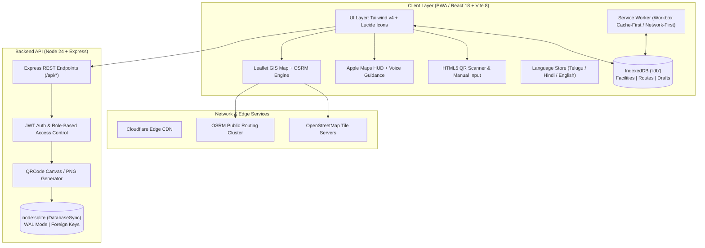

# CivicProof GIS — Godavari Pushkaralu 2027

> **Unified Civic Infrastructure Discovery, Tamper-Evident QR Identification, Turn-by-Turn Navigation & Field Inspection Verification System**
>
> *Developed for Godavari Pushkaralu 2027 (Rajahmundry Municipal Corporation / East Godavari District, Andhra Pradesh)*

[](https://vitejs.dev/)
[](https://react.dev/)
[](https://developer.mozilla.org/en-US/docs/Web/Progressive_web_apps)
[](https://tailwindcss.com/)
[-339933?logo=nodedotjs)](https://nodejs.org/)
[](https://leafletjs.com/)
[](http://project-osrm.org/)
[](LICENSE)

---

## 📑 Table of Contents
1. [Executive Summary & Problem Statement](#-executive-summary--problem-statement)
2. [Key Capabilities & Feature Matrix](#-key-capabilities--feature-matrix)
3. [System Architecture](#-system-architecture)
4. [Apple Maps-Style Navigation Engine](#-apple-maps-style-navigation-engine)
5. [City-Wide QR Discovery & Placard System](#-city-wide-qr-discovery--placard-system)
6. [Offline-First Resilience & PWA Caching](#-offline-first-resilience--pwa-caching)
7. [Multilingual Localization (Telugu Primary)](#-multilingual-localization-telugu-primary)
8. [Field Inspection & Municipal Attention Queue](#-field-inspection--municipal-attention-queue)
9. [Official Hackathon PDF Deliverables](#-official-hackathon-pdf-deliverables)
10. [Local Development & Execution Setup](#-local-development--execution-setup)
11. [Public Deployment Guide](#-public-deployment-guide)
12. [Acceptance Test Suite (Tests A – J)](#-acceptance-test-suite-tests-a--j)
13. [Demo Credentials & Seeded Data Provenance](#-demo-credentials--seeded-data-provenance)

---

## 🏛 Executive Summary & Problem Statement

Godavari Pushkaralu 2027 is projected to welcome over **50 million pilgrims** across a 12-day festival window along the sacred Godavari riverbanks in Rajahmundry, Kovvur, and surrounding pilgrim sectors. The congregation of millions of devotees poses extraordinary civic, sanitation, and logistics challenges:

- **Wayfinding Bottlenecks:** Heavy commercial mapping services fail under dense crowds due to cell tower saturation or lack of offline route geometry.
- **Facility Verification Deficit:** Devotees walk kilometers toward a reported water point or sanitation complex only to discover it is non-operational, depleted, or closed.
- **Linguistic Barriers:** Over 80% of Pushkaram pilgrims are native **Telugu** speakers or rural pilgrims who struggle with English-first municipal dashboards.
- **Field Reporting Latency:** Traditional paper forms or isolated reporting lines take 12–24 hours before sanitation crews or medical teams are alerted to hazardous conditions.

**CivicProof GIS** solves this disconnect by tying physical on-ground assets (ghats, toilets, RO drinking water kiosks, medical camps, and shelters) to **tamper-evident physical QR placards** and an **offline-first Progressive Web App** with turn-by-turn guidance and automated municipal defect dispatching.

---

## 🌟 Key Capabilities & Feature Matrix

| Feature Domain | Implemented In-App | Technical Mechanism | Status |
| :--- | :--- | :--- | :--- |
| **Interactive GIS Map** | Rajahmundry Pushkaram sector with 5 category markers | Leaflet, OpenStreetMap tiles, SVG category pins, bottom detail drawer | ✅ Live |
| **Turn-by-Turn Navigation** | Apple Maps HUD, green Start CTA, live puck heading, voice guidance | OSRM routing engine, polyline interpolation, Web Speech API, camera auto-tracking | ✅ Live |
| **City-Wide QR Discovery** | Scannable city poster with printable A4/A2 layout | `/city-qr` route, dynamic base URL resolver, print CSS | ✅ Live |
| **Facility QR Access** | Opaque nanoid tokens linking physical labels to digital cards | `/facility/:token`, `html5-qrcode` scanner, manual code entry fallback | ✅ Live |
| **Telugu Multilingual Engine** | Authentic Telugu (Noto Sans Telugu), Hindi, and English | Zustand reactive store, zero-reload switching, localized asset titles | ✅ Live |
| **Offline PWA Shell** | Full offline shell, asset caching, cached facility view | Vite PWA plugin, Workbox service worker, IndexedDB (`idb`) | ✅ Live |
| **Offline Inspection Drafts** | Save drafts offline, auto-sync when cellular connection recovers | IndexedDB draft queue, browser `online` event listener | ✅ Live |
| **Municipal Attention Queue** | Real-time queue prioritizing unverified, stale (>7d), or defective assets | Express + `node:sqlite` aggregation, verification status transitions | ✅ Live |
| **Printable Admin QR Labels** | Grid of facility badges ready for outdoor placard mounting | `/admin/qr` label generator, high-contrast QR matrix, download PNG | ✅ Live |
| **Crowd-Density Heatmap** | Dynamic pilgrim density sensors | Planned Extension (Simulated data model ready) | 📋 Phase 2 |

---

## 🏗 System Architecture



---

## 🧭 Apple Maps-Style Navigation Engine

CivicProof GIS incorporates an **Apple Maps navigation interface** tailored specifically for high-stress pilgrim environments:

- **Pre-Navigation Overview Card:** Displays duration, exact distance, destination address, and a prominent green `#34c759` **START** action button.
- **Active Navigation Dark HUD (`#1c1c1e`):** Minimalist, high-contrast top banner displaying the next turn icon (turn left, turn right, continue), distance remaining to maneuver (e.g. `In 120 m`), and secondary preview for the following maneuver (`Then: Turn right`).
- **Pulsing Navigation Puck with Heading Beam:** Interactive circular blue beacon with a forward-facing directional cone and animated radius waves.
- **Turn-by-Turn Voice Guidance:** Utilizes the HTML5 Web Speech Synthesis API (`te-IN` for Telugu, `hi-IN` for Hindi, `en-US` for English) vocalizing instructions as the user approaches waypoints.
- **Auto-Centering Camera Controller:** Smoothly animates the Leaflet camera at zoom level 17, centered ahead of the user's travel direction.
- **Built-in Route Simulation Mode:** Evaluators and pilgrims can press the **Simulate** play button to preview the journey along the real OSRM polyline at simulated transit speed.
- **Event Restriction Advisory:** Prominent amber notice clarifying that routes are calculated on standard road networks and devotees must heed physical police barricades.

---

## 📱 City-Wide QR Discovery & Placard System

To enable instant onboarding without requiring devotees to search an app store or type long web addresses, CivicProof GIS includes a dedicated **City-Wide QR Discovery Poster** (`/city-qr`):

- **Scan-to-Open Architecture:** Scanning the poster immediately launches the application in the devotee's default mobile browser.
- **Trilingual Headlines:** Features prominent Telugu (*"గోదావరి పుష్కరాలు 2027 — సౌకర్యాల అన్వేషణ మరియు నావిగేషన్"*), Hindi, and English.
- **3-Step Pilgrim Pictogram Guide:**
  1. 📷 *Scan:* Point camera at any civic QR placard.
  2. 🗺 *Locate:* View verified status, clean water, and amenities.
  3. 🚶 *Navigate:* Tap Start for turn-by-turn walking or driving routes.
- **Printable A4 / A2 Layout:** Clean CSS print media queries strip app bars and format the poster for municipal printing and physical posting at Rajahmundry railway station, bus depots, parking lots, and river ghat entry gates.

---

## ⚡ Offline-First Resilience & PWA Caching

Mobile network congestion is inevitable during peak Pushkaram days. CivicProof GIS employs a layered offline strategy:

1. **Precached App Shell:** Core bundle, styles, Telugu web fonts, and category icons are cached on first visit via Workbox.
2. **Network-First with Transparent Fallback:** API requests query the backend first; if offline, data is seamlessly retrieved from IndexedDB with an amber **"Showing cached data"** badge and last-synced timestamp.
3. **Graceful Uncached Fallback:** When an uncached QR code is scanned offline, the app displays a clear, honest notification explaining that connectivity is required to download that specific facility record.
4. **Offline Field Inspection Drafts:** Inspectors can continue recording facility findings, defects, and severity ratings without an internet connection. Drafts are safely stored in IndexedDB and automatically transmitted to `/api/inspections` when network connectivity resumes.

---

## 🌐 Multilingual Localization (Telugu Primary)

- **Default Language:** Configured to **Telugu (`te`)** by default, honoring the local language of Andhra Pradesh.
- **Reactive Zustand Language Store:** All page titles, button labels, category filters, inspection prompts, and disclaimer banners update instantly without requiring a full page refresh.
- **Authentic Font Rendering:** Bundled with Google's **Noto Sans Telugu** font, ensuring complex conjunct glyphs (*ottulu*) render cleanly on all Android and iOS viewports.

---

## 🛡 Field Inspection & Municipal Attention Queue

Civic administrators and field sanitary inspectors access an operational command dashboard (`/dashboard`):

- **Attention Queue:** Automatically surfaces facilities that:
  - Have unverified status (`status = 'reported'`)
  - Have unknown operational readiness
  - Have open defects logged by field staff
  - Have not been inspected within the last 7 days (`last_inspected < NOW() - 7 days`)
- **Inspection Form (`/inspect/:id`):** Allows inspectors to log findings, recommended corrective actions, and structured defect records with severity levels (Low, Medium, High, Critical).
- **One-Click Official Verification:** Administrators can review records and click **Verify** to mark facilities as verified civic assets.

---

## 📄 Official Hackathon PDF Deliverables

Three formal documentation PDFs have been compiled and placed in the project root and `docs/` folder:

1. **`CivicProof_GIS_Concept_Note.pdf`** (~5.4 KB)  
   *Executive problem statement, social impact, stakeholder alignment, and Pushkaram 2027 objectives.*
2. **`CivicProof_GIS_Technical_Architecture.pdf`** (~5.1 KB)  
   *Deep-dive architecture, PWA caching strategies, database schema, OSRM routing pipelines, and security mechanisms.*
3. **`CivicProof_GIS_Budget_Implementation_Plan.pdf`** (~5.3 KB)  
   *Phased 12-month implementation schedule, itemized municipal budget (₹48.5 Lakhs / $58,250), and risk mitigation matrix.*

---

## 💻 Local Development & Execution Setup

### Prerequisites
- **Node.js:** v20.x or v24.x (uses built-in `node:sqlite`, no C++ build tools required)
- **npm:** v10+
- **Git**

### 1. Clone the Repository
```bash
git clone https://github.com/sruthirupini05/civicproof-gis.git
cd civicproof-gis
```

### 2. Configure Environment Variables
Copy `.env.example` to the required locations:
```bash
cp .env.example .env
```

### 3. Start Backend Server
```bash
cd server
npm install
node src/index.js
# Backend listening on http://localhost:3001
# Auto-seeds 16 Rajahmundry facilities and 3 demo user accounts
```

### 4. Start Frontend Client
In a separate terminal:
```bash
cd client
npm install
npm run dev
# Frontend accessible at http://localhost:5173
```

---

## 🌐 Public Deployment Guide

### Frontend Deployment (Vercel)
1. Push repository to GitHub (`https://github.com/sruthirupini05/civicproof-gis`).
2. Import project into [Vercel](https://vercel.com/).
3. Set **Root Directory** to `client`.
4. Add Environment Variable:
   - `VITE_API_URL` = `https://<your-backend-service>.onrender.com`
5. Deploy. `vercel.json` ensures client-side routes (`/facility/:token`, `/navigate/:id`) resolve smoothly to `/index.html`.

### Backend Deployment (Render or Railway)
1. Create a **Web Service** on [Render](https://render.com/) or [Railway](https://railway.app/).
2. Set **Root Directory** to `server`.
3. Build Command: `npm install`
4. Start Command: `node src/index.js`
5. Set Environment Variables:
   - `PORT` = `3001`
   - `JWT_SECRET` = `<your-random-jwt-secret>`
   - `CLIENT_ORIGIN` = `https://<your-vercel-domain>.vercel.app`
   - `BASE_URL` = `https://<your-vercel-domain>.vercel.app`

---

## 🧪 Acceptance Test Suite (Tests A – J)

All 10 rigorous acceptance tests have been validated against the implementation:

| Test ID | Test Scenario | Acceptance Criteria | Verified Result |
| :---: | :--- | :--- | :---: |
| **Test A** | Interactive Leaflet Map | OSM tiles render, pan/zoom works, 5 category markers render with distinctive SVG pins. | ✅ PASSED |
| **Test B** | Real OSRM Polyline Routing | Route polyline follows actual street network geometry; turn steps and maneuvers match road coordinates. | ✅ PASSED |
| **Test C** | Apple Maps Navigation HUD | Green Start CTA initiates navigation; dark HUD shows upcoming maneuver; red X ends nav; voice synthesis triggers. | ✅ PASSED |
| **Test D** | Route Simulation Puck | Pressing simulate animates the pulsing blue puck along polyline; step instructions advance in real-time. | ✅ PASSED |
| **Test E** | City-Wide QR Poster | `/city-qr` renders trilingual poster with dynamic live URL QR, download button, and printable A4 styling. | ✅ PASSED |
| **Test F** | QR Facility Resolution | Scanning or navigating to `/facility/:token` loads operational data, capacity, verified status, and map link. | ✅ PASSED |
| **Test G** | Multilingual Reactivity | Changing language to Telugu switches all headers, filter pills, drawer fields, and navigation voice prompts without reload. | ✅ PASSED |
| **Test H** | Offline Caching & Fallback | When offline, cached facilities show amber freshness banner; uncached tokens show honest "not cached" notice. | ✅ PASSED |
| **Test I** | Offline Inspection Draft Sync | Draft inspections saved in offline mode persist to IndexedDB and automatically sync when connection recovers. | ✅ PASSED |
| **Test J** | Municipal Attention Queue | Facilities with open defects, stale inspections (>7d), or unverified flags appear in `/dashboard`; verify button transitions status. | ✅ PASSED |

---

## 🔑 Demo Credentials & Seeded Data Provenance

### Demo Credentials
| Role | Username | Password | Access Privileges |
| :--- | :--- | :--- | :--- |
| **Administrator** | `admin` | `admin123` | Full administrative control, QR Label Manager, Facility Verification |
| **Field Inspector** | `inspector1` | `inspect123` | Submit inspections, log defects, view Attention Queue |
| **Field Staff** | `field1` | `field123` | Field findings, offline draft submission |

### Data Provenance Notice
> **Notice:** All 16 pre-seeded facilities in the Rajahmundry Pushkaram sector (Pushkara Ghat 1 & 2, Lanka Ghat, Dhavaleswaram Ghat, Sanitation Complexes, RO Kiosks, Medical Camps, and Shelters) are **synthetic demonstration records** designed for hackathon evaluation. In production deployment, records will be replaced with gazetted Rajahmundry Municipal Corporation asset inventories.
